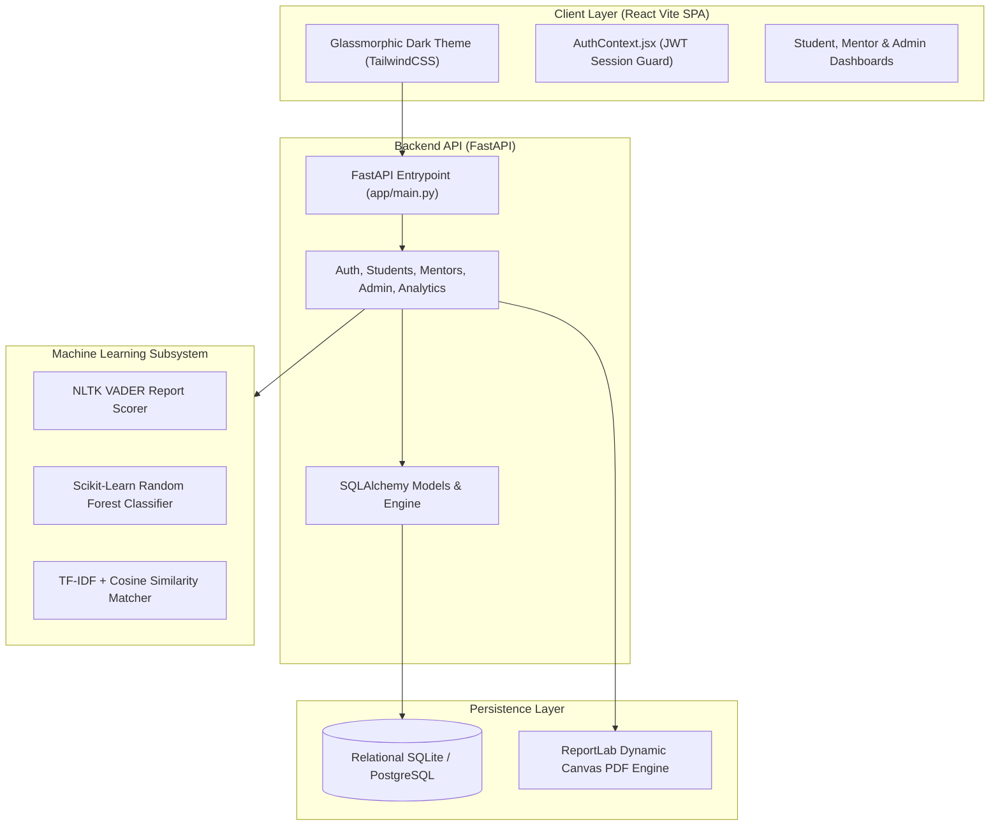

# Nexora Internship Portal (Antigravity Control) — Technical Manual

**Version:** 2.0.0 (Release)  
**System Name:** Nexora Internship Portal (Antigravity Control)  
**Repository:** `internship porta`  
**Core Technologies:** Python 3.10+, FastAPI, SQLAlchemy, SQLite, React (Vite SPA), Tailwind CSS, Scikit-Learn, NLTK  
**Last Updated:** October 2026  

---

## 1. Executive Overview & Mission

**Nexora's Internship Portal** is an AI-driven, enterprise-grade centralized ecosystem designed to streamline and automate the internship lifecycle for Students, Academic Mentors, and Administrators.

### Key Capabilities:
- **Student Intern Workspace:** Task checklists, daily progress log submissions, milestone gauges, and AI-recommended learning modules.
- **Academic Mentor Console:** Submission review queues, qualitative feedback entry, task grading (0-100), and automated student risk indicators.
- **Administrator Control Deck:** Cohort allocation, student-to-mentor mappings, system-wide analytics, and automated PDF certificate issuing.
- **AI/ML Engine:**
  - **NLP Daily Report Quality Scorer:** Composite mathematical evaluation based on NLTK VADER sentiment analysis, word count log-normalization, and structural formatting heuristics.
  - **Random Forest Performance Classifier:** Continuous multi-metric classifier categorizing intern trajectory into `Outstanding`, `On Track`, or `At Risk`.
  - **Task & Curriculum Recommender:** TF-IDF vectorization and Cosine Similarity matching intern skills with project tasks.
- **Automated Certificate Issuance:** ReportLab dynamic layout engine generating PDF completion certificates with unique cryptographic verification hashes.

---

## 2. System Architecture & Tech Stack



---

## 3. AI Model Formulations

### Model 1: NLP Report Quality Scoring Formula
$$\text{Score} = (0.40 \times \text{Length}) + (0.30 \times \text{Structure}) + (0.30 \times \text{Sentiment})$$

### Model 2: Random Forest Performance Classifier
Predicts probability distributions over three output classes:
- `Outstanding`: Task completion $\ge 90\%$, Average score $\ge 85$.
- `On Track`: Standard progress meeting baseline rubric.
- `At Risk`: Flagged when attendance dips, late submissions $> 20\%$, or score $< 60$.

### Model 3: Skill-Task Cosine Similarity
$$\text{Similarity}(\vec{A}, \vec{B}) = \frac{\vec{A} \cdot \vec{B}}{\|\vec{A}\| \|\vec{B}\|}$$
Matches TF-IDF tokenized student skills against task description vectors.

---

## 4. REST API Endpoint Reference

| Method | Endpoint | Access | Description |
|---|---|---|---|
| `POST` | `/api/auth/login` | Public | Authenticates credentials and returns JWT token |
| `POST` | `/api/auth/register` | Public | Registers Student, Mentor, or Admin account |
| `GET` | `/api/students/tasks` | Student | Retrieves assigned tasks and progress checklist |
| `POST` | `/api/students/reports` | Student | Submits daily log and triggers NLP scoring |
| `GET` | `/api/mentors/students` | Mentor | Lists assigned students with performance risk badges |
| `POST` | `/api/mentors/evaluate` | Mentor | Grades submissions and logs mentor feedback |
| `POST` | `/api/admin/certificates/generate` | Admin | Generates cryptographically verified ReportLab PDF |

---

## 5. Local Setup & Credentials

```bash
# 1. Start Backend Server
cd backend
pip install -r requirements.txt
python scripts/seed_db.py
python run.py
# API running on http://127.0.0.1:8000 (Swagger docs at /docs)

# 2. Start Frontend SPA
cd ../frontend
npm install
npm run dev
# Interface running on http://localhost:3000
```

### Pre-Configured Admin Login:
- **Email:** `trivin@nexora.com`
- **Password:** `Nexora@123`

---
*Official Technical Documentation for Nexora Internship Portal (`internship porta`).*
